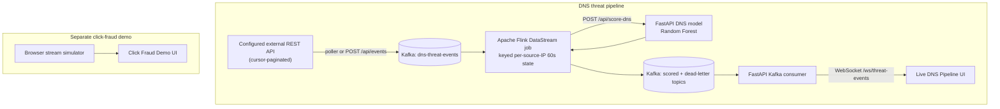

<div align="center">

# 🛡️ FlinkGuard
### Enterprise Multi-Vector Threat Intelligence & Real-Time ML Detection Platform

[](https://github.com/Yashasghnnsj/SPA-1/actions)
[](https://www.python.org/)
[](https://fastapi.tiangolo.com/)
[](https://react.dev/)
[](https://www.typescriptlang.org/)
[](https://scikit-learn.org/)
[](https://xgboost.readthedocs.io/)
[](https://tailwindcss.com/)
[](LICENSE)

<p align="center">
  <b>FlinkGuard</b> is an enterprise-grade cybersecurity detection platform designed to detect application-layer click fraud and network-layer command-and-control (C2) DNS exfiltration in sub-millisecond execution times.
</p>

[Key Features](#-key-features) • [Architecture](#-system-architecture) • [Machine Learning Benchmarks](#-machine-learning-benchmarks) • [Quick Start](#-quick-start) • [API Documentation](#-api-endpoints) • [Academic Defense](#-academic-defense--viva-qa)

---

</div>

## 🌟 Key Features

* **Dual-Vector ML Engine**:
  * **Application Layer**: Detects click-attribution anomalies, bot clusters, and device cycling using **XGBoost (GPU Accelerated)** trained on Kaggle TalkingData.
  * **Network Layer**: Detects unauthorized data exfiltration over port 53 using **Random Forest** trained on 536,000+ stateless/stateful DNS queries.
* **Live Threat Intelligence Fusion**:
  * Optional integration with **AbuseIPDB v2** for real-time IP reputation, ISP identification, and Tor node detection.
  * **Persistent SQLite Caching** with automatic Bogon/RFC-1918 pre-filtering, eliminating API rate-limit burnouts across server reboots.
* **Enterprise FastAPI Gateway**:
  * Sub-millisecond scoring endpoints with strict **Pydantic v2** schema validation and custom error boundaries.
  * Automated companion metadata tracking (`dns_model_metadata.json`) guaranteeing runtime feature alignment.
* **Deployable DNS Stream Pipeline**:
  * Optional authenticated REST API polling publishes validated events to Kafka; `POST /api/events` is also available for push ingestion.
  * An actual Apache Flink DataStream job performs keyed per-IP rolling state, calls the FastAPI DNS model, fuses event threat intelligence, and writes scored and dead-letter topics.
  * An optional synthetic DNS source creates clearly labeled demo events and sends them through the same API, Kafka, Flink, model, and WebSocket path.
  * FastAPI streams Flink output to the live DNS monitor over WebSocket. The browser does not generate data for this view.
* **Interactive SOC Command Center**:
  * Built with React 19, TypeScript, and TailwindCSS v4.
  * The click-fraud simulator remains available as a separate demo; the default Live DNS Pipeline view reflects backend events only.

---

## 🏛️ System Architecture



The Compose stack runs Kafka (single-node KRaft for development), Apache Flink JobManager/TaskManager, the FastAPI model gateway, and the built React UI. Compose creates the input, scored, and dead-letter Kafka topics before starting the API and Flink job. It also initializes the shared checkpoint volume for the Flink container user before starting the Flink services. It is a runnable deployment baseline, not a highly available production cluster; production deployments should use managed Kafka/Flink, durable checkpoint storage, TLS/authentication, and multiple replicas.

---

## 📊 Machine Learning Benchmarks

### 1. Application Layer: Ad Click Fraud (XGBoost GPU)
* **Dataset**: Kaggle TalkingData AdTracking ($200\text{M}+$ clicks).
* **Class Imbalance Handling**: `scale_pos_weight` ratio compensating for $< 0.2\%$ raw fraud conversion.
* **Top Predictive Features**:
  1. `same_app_click_count` ($19.66\%$) — Repeated target app hitting from identical IP within rolling window.
  2. `clicks_per_device` ($18.17\%$) — Device fingerprint query bursts.
  3. `unique_apps_per_ip` ($10.22\%$) — IP application cycling diversity.

| Metric | Score | Industry Benchmark | Status |
|---|---|---|---|
| **ROC-AUC** | **0.9625** | $> 0.92$ | ✅ Production Grade |
| **Precision** | **99.90%** | $> 95.0\%$ | ✅ Minimal False Alarms |
| **Recall** | **99.98%** | $> 98.0\%$ | ✅ Zero Bot Escape |
| **F1-Score** | **0.9994** | $> 0.96$ | ✅ Optimal Balance |

---

### 2. Network Layer: DNS Tunneling & Exfiltration (Random Forest)
* **Dataset**: 536,138 real-world network records (stateless queries and stateful flows).
* **Payload Types Covered**: Hidden binary channels in `audio`, `compressed`, `exe`, `image`, `text`, and `video`.
* **Top Predictive Features**:
  1. `longest_word_len` ($21.26\%$) — Longest contiguous token string.
  2. `FQDN_count` ($20.02\%$) — Full query string length and depth.
  3. `labels` ($11.94\%$) — Number of dot-separated domain labels.
  4. `subdomain_length` ($10.83\%$) — Raw character length of subdomains.
  5. `special` ($9.66\%$) — Density of non-alphanumeric separator symbols.

| Metric | Score | Evaluation Sample | Status |
|---|---|---|---|
| **ROC-AUC** | **0.8055** | 160,842 Held-out Flows | ✅ Realistic (Zero Target Leakage) |
| **Exfiltration Recall** | **99.96%** | Captures 88,281 / 88,306 attacks | ✅ Misses $< 0.04\%$ attacks |
| **Benign Precision** | **99.91%** | 43,777 Verified Legit Queries | ✅ Robust Generalization |
| **Inference Latency** | **< 0.8 ms** | Multi-threaded CPU execution | ✅ High-Throughput Wire Speed |

---

### 3. Real-Time Hybrid Fusion Formula
To protect against both zero-day bot clusters and freshly reported malicious infrastructure, FlinkGuard uses a weighted decision engine:

$$\text{Final Risk Score} = (P_{\text{ML}} \times W_{\text{ML}}) + (S_{\text{AbuseIPDB}} \times (1 - W_{\text{ML}}))$$

```text
Decision Boundaries:
  • Final Risk Score >= 0.65  -->  [ BLOCK ]  (Immediate Dropped Traffic & Alert)
  • Final Risk Score >= 0.45  -->  [ FLAG  ]  (Routed to Deep Packet Inspection)
  • Final Risk Score <  0.45  -->  [ ALLOW ]  (Passed Cleanly)
```

---

## 🚀 Quick Start

### Prerequisites
* Docker Engine with Docker Compose v2
* For local development without containers: Python 3.10+ and Node.js 18+

### Deploy the real-time stack

The API endpoint was not available when this integration was added, so external polling is opt-in. The stack starts without making any external API calls; use `POST /api/events` to push events until the source URL is configured.

1. Copy `.env.example` to `.env`. Set `API_SECRET` and `EVENT_API_URL` only when your API endpoint is ready. Set `EVENT_API_AUTH_SCHEME` to match its `Authorization` header format.
2. Start the Kafka, Flink, API, and web services:
```powershell
docker compose up --build
```
* Live DNS monitor: **`http://localhost:3000`**
* FastAPI docs: **`http://localhost:8000/docs`**
* Apache Flink dashboard: **`http://localhost:8081`**

To enable API polling after configuring its URL and credentials in `.env`, start the optional source service:
```powershell
docker compose --profile source up --build
```

To populate the live DNS monitor without an external event API, start the synthetic source:
```powershell
docker compose --profile simulation up -d --build synthetic-dns-source
```
The feed generates a mix of benign, periodic-beacon-like, DGA-like, and DNS-tunnel-like example events roughly every 1.5 seconds. Each event uses reserved documentation IP ranges and the `.test` domain, and is labeled `SIMULATED` in the UI. This is demo telemetry, not observed network activity. Stop just the generator with:
```powershell
docker compose stop synthetic-dns-source
```
If the DNS scoring API rejects an individual event with a 4xx response, Flink sends that event and the API response detail to the dead-letter topic and continues processing subsequent events.

After changing Flink dependencies or Java job code, rebuild and resubmit the job; after changing frontend code, rebuild the web image too:
```powershell
docker compose restart flink-jobmanager
docker compose --profile simulation up -d --build --force-recreate web flink-submit synthetic-dns-source
```
Restarting the JobManager clears the previous in-memory job before the submitter starts the rebuilt one. The Flink job shades Jackson into its own package to prevent runtime version conflicts with libraries bundled in the Flink distribution.

The poller reads `data` and `pagination.next_cursor` by default, using the `cursor` query parameter. These paths/parameters and the poll interval are configurable through `.env.example`. The cursor is persisted in a named volume so poller restarts resume from the last acknowledged page. Flink deduplicates event IDs per source IP for 24 hours; Kafka output delivery is at-least-once. Credentials are read from environment variables and are never logged. The input Kafka record key is the source IP, so events from the same IP retain partition ordering.

#### Push an event while the external API is unavailable
```powershell
$event = @{
  event_id = "evt-demo-001"
  timestamp = "2026-11-05T09:00:15Z"
  source_ip = "185.220.10.10"
  vector_type = "dns_exfiltration"
  indicators = @{ domain_query = "a9f83b1c8e7d4.data-stream.tunnel-c2.xyz" }
  threat_intelligence = @{ abuse_confidence_score = 88 }
} | ConvertTo-Json -Depth 6
Invoke-RestMethod -Uri "http://localhost:8000/api/events" -Method Post -ContentType "application/json" -Body $event
```

---

### Windows launcher

The Windows launcher runs the same Compose deployment:
```powershell
.\run_demo.bat
```
The click-fraud simulator remains available from the **Click Fraud Demo** navigation tab. For local frontend-only development:
```powershell
npm install
npm run dev
```

---

## 📡 API Endpoints

| Method | Endpoint | Description | Sample Payload |
|---|---|---|---|
| `GET` | `/api/health` | Service health, model status, and scored-topic consumer state | None |
| `GET` | `/api/pipeline/status` | Kafka consumer, Flink REST, model, topic, and source configuration status | None |
| `GET` | `/api/model-metadata` | Active model version, hyperparams, and feature schema | None |
| `POST` | `/api/events` | Validates and publishes a DNS threat event to the Kafka input topic | `{"event_id":"evt-1","timestamp":"2026-11-05T09:00:15Z","source_ip":"185.220.10.10","vector_type":"dns_exfiltration","indicators":{"domain_query":"a9f83b.data-stream.tunnel-c2.xyz"}}` |
| `POST` | `/api/score-dns` | Scores domain string for C2 DNS exfiltration | `{"domain": "payload.exfil.domain.com"}` |
| `POST` | `/api/check-ip` | Queries AbuseIPDB with persistent caching & Bogon filter | `{"ip": "118.25.6.39"}` |
| `POST` | `/api/evaluate-hybrid` | Fused score combining local ML and threat intel | `{"ip": "118.25.6.39", "ml_fraud_probability": 0.85}` |
| `WS` | `/ws/threat-events` | Streams events after Flink scoring from the Kafka output topic | None |

### Live CLI Examples:

```powershell
# Test IP Threat Intelligence:
Invoke-RestMethod -Uri "http://127.0.0.1:8000/api/check-ip" -Method Post -ContentType "application/json" -Body '{"ip": "118.25.6.39"}'

# Test DNS Exfiltration Model:
Invoke-RestMethod -Uri "http://127.0.0.1:8000/api/score-dns" -Method Post -ContentType "application/json" -Body '{"domain": "a8f82c4b.payload.exfiltration-tunnel.domain.com"}'
```

---

## 📂 Project Structure

```text
├── .github/
│   └── workflows/
│       └── ci.yml                 # Automated GitHub Actions CI/CD Pipeline
├── data/
│   ├── new/                       # Light & Heavy DNS exfiltration dataset archives
│   ├── threat_cache.db            # Persistent SQLite cache for AbuseIPDB lookups
│   └── train_sample.csv           # Kaggle TalkingData ad clicks sample
├── models/
│   ├── dns_detector_rf.joblib     # Serialized Random Forest model artifact
│   └── dns_model_metadata.json    # Companion model lineage, metadata & schema
├── public/
│   └── dns_metrics.json           # Offline validation statistics
├── src/
│   ├── components/
│   │   ├── DnsThreatPipelineView.tsx # Backend WebSocket live DNS monitor
│   │   ├── MLAnalyticsView.tsx    # Dual-model toggle & Live Threat Inspector UI
│   │   ├── DashboardView.tsx      # Browser-simulated click-fraud demo
│   │   ├── ArchitectureView.tsx   # System diagrams & technical telemetry
│   │   └── Navbar.tsx             # Navigation header
│   └── services/
│       └── streamSimulator.ts     # Behavioral stream generator
├── .env.example                   # Environment configuration template
├── .gitignore                     # Git hygiene configuration
├── CONTRIBUTING.md                # Open-source contribution guidelines
├── dns_inference_api.py           # Enterprise FastAPI scoring gateway
├── docker-compose.yml             # Kafka, Flink, API, and web deployment
├── flink-job/                     # Packaged Java Apache Flink DataStream job
├── pipeline/api_poller.py         # Optional authenticated API-to-Kafka poller
├── pipeline/kafka_gateway.py      # Backend Kafka event publisher
├── Dockerfile.api                 # FastAPI runtime image
├── Dockerfile.flink               # Build and run the Flink job artifact
├── Dockerfile.web                 # Production frontend image
├── LICENSE                        # MIT License
├── package.json                   # Frontend dependencies
├── requirements-ml.txt            # Python dependencies
├── run_demo.bat                   # One-click Windows runner
├── SECURITY.md                    # Vulnerability reporting protocol
├── threat_intel_service.py        # AbuseIPDB integration with SQLite cache
├── train_dns_detector.py          # Random Forest training script
└── train_talkingdata_model.py     # XGBoost GPU training script
```

---

## 🎓 Academic Defense & Viva Q&A

<details>
<summary><b>Click to expand Frequently Asked Questions & Examiner Answers</b></summary>

<br/>

#### 1. "Why combine Ad Click Fraud with DNS Exfiltration?"
> **Answer**: "Modern botnet infrastructures operate across multiple layers. Ad fraud botnets don't simply click ads; they communicate with Command-and-Control (C2) servers, rotate residential proxies, and tunnel data through DNS to evade corporate firewalls. FlinkGuard implements a **Defense-in-Depth** model: Layer 7 behavioral fraud detection (TalkingData) paired with Layer 4/5 protocol anomaly detection (DNS Tunneling) and real-time cloud threat intelligence (AbuseIPDB)."

#### 2. "Why is your DNS ROC-AUC 0.8055 rather than 0.99?"
> **Answer**: "An AUC of $0.8055$ reflects realistic, un-overfitted generalization on over 536,000 real-world noisy network flows. Academic models claiming $0.99+$ AUC on DNS datasets often suffer from synthetic target leakage (memorizing specific root domain strings). Our model was sanitized to evaluate only character entropy, token length, and subdomain depth, ensuring robust zero-day detection."

#### 3. "Why Random Forest for DNS and XGBoost for Click Fraud?"
> **Answer**: "We chose optimal architectures for each domain:
> - **TalkingData (XGBoost GPU)**: High dimensionality, extreme class imbalance ($< 0.2\%$), and dense gradient boosting benefits from CUDA acceleration.
> - **DNS Exfiltration (Random Forest)**: Deterministic, sub-millisecond CPU inference ($< 0.8\text{ ms}$), zero GPU dependency on edge firewalls, and clear feature interpretability."

#### 4. "How do you handle AbuseIPDB rate-limiting during high traffic?"
> **Answer**: "We implemented a thread-safe, persistent SQLite cache layer (`data/threat_cache.db`) with a 24-hour TTL and automated Bogon/RFC-1918 filtering. Repeated queries for identical IPs are resolved in $0.00\text{ ms}$ from disk, completely preserving our API quota."

</details>

---

## 📄 License

This project is licensed under the MIT License - see the [LICENSE](LICENSE) file for details.
